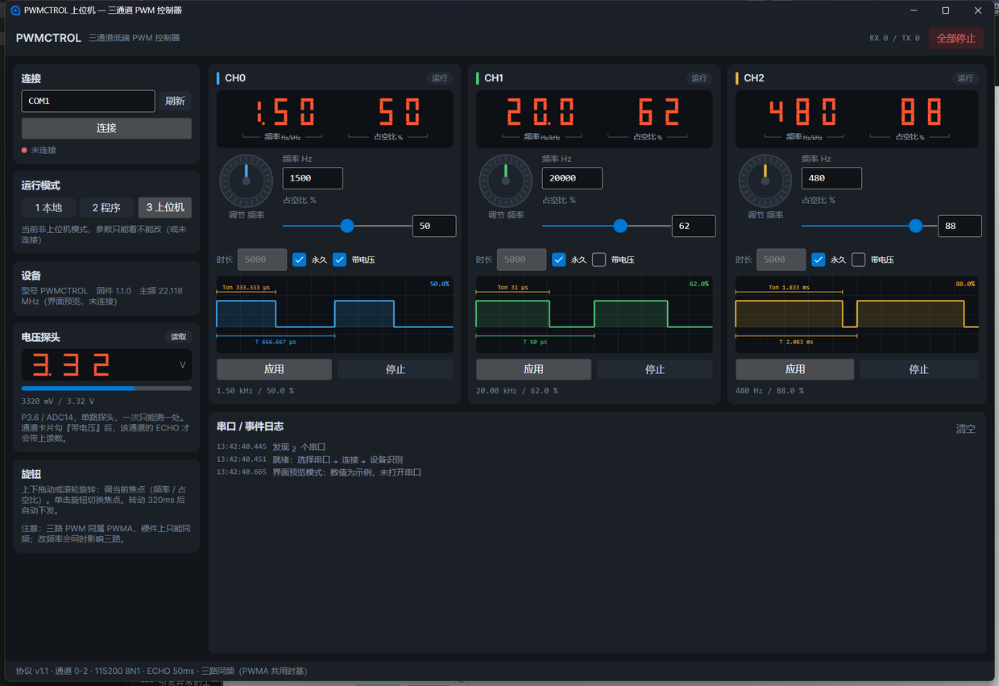

# PWMCTROL 上位机（Avalonia）实现说明

| 项 | 内容 |
| --- | --- |
| 文档编号 | APP-001 |
| 版本 | v1.0 |
| 日期 | 2026-11-13 |
| 工程 | `PWMCtrol/PWMCtrol/PWMCtrol.csproj`（net8.0 / Avalonia 11.3 / CommunityToolkit.Mvvm 8.2.1） |
| 协议 | PROTO v1.1（通道 0-2、ECHO 帧、E13 模式闸门） |
| 界面 |  |

---

## 1. 设计取向

沿用模拟器的视觉语言（深色面板、红色七段、旋钮、卡片），但**按"每个通道一个旋钮 + 一个波形预览"重构**：

- 下位机面板是"一块屏 + 一个旋钮"共用；上位机是"三块卡片并排"，操作三路时不用切通道。
- 卡片里的旋钮只改本通道参数，单击在"频率 / 占空比"之间切焦点，滚轮/拖动都能转。
- 所有自绘控件零第三方依赖：七段、旋钮、波形都是 `Control.Render` 画的。

## 2. 文件结构

```
PWMCtrol/
├─ Models/                   协议与传输（不依赖 UI）
│  ├─ SerialTransport.cs     串口开关与原始字节收发（DataReceived 事件）
│  ├─ FrameCodec.cs          字节流 → [ … ] 帧，超长帧整帧丢弃
│  ├─ DeviceSession.cs       一问一答调度：ECHO 分流、命令超时、握手
│  ├─ ChannelEcho.cs         ECHO 帧解析
│  ├─ LogEntry.cs            日志条目（含颜色）
│  └─ SelfTest.cs            --selftest：协议层纯逻辑自检
├─ Controls/                 自绘控件（无第三方）
│  ├─ SegmentDisplay.cs      七段数码管，Text + Dots 两个属性
│  ├─ BracketLabel.cs        括号丝印：下划线断开写标签（"频率 / Hz·kHz"）
│  ├─ RotaryKnob.cs          EC11 旋钮：拖动/滚轮出步进，单击出 ClickCommand
│  └─ PwmPreview.cs          单通道方波预览，带 Ton / T 测量标注
├─ ViewModels/
│  ├─ MainWindowViewModel.cs 连接、模式权限、命令下发、ECHO 分发、日志
│  └─ ChannelViewModel.cs    单通道：本地设定值 + 旋钮步进 + 生效值回填
└─ Views/
   ├─ MainWindow.axaml       三列布局：左栏连接/模式/说明，右栏三卡片 + 日志
   └─ ChannelCard.axaml      通道卡片（七段 + 旋钮 + 参数 + 预览 + 按钮）
```

## 3. 线程与数据流

```
串口 DataReceived（线程池）
   └─ FrameCodec → DeviceSession.HandleFrame
        ├─ ECHO_*  → EchoReceived → Dispatcher.UIThread.Post → ChannelViewModel.ApplyEcho
        ├─ EVT_*   → 只记日志，不占应答
        └─ 其他    → 完成当前等待的 TaskCompletionSource（命令应答）
UI 线程
   └─ ChannelViewModel.StepCommand → 值变 → 320ms 防抖 → IChannelHost.ApplyAsync → CONFIG
```

要点：

- **命令严格串行**：`SemaphoreSlim(1,1)` 保证一问一答，避免"回包串到别的命令上"。
- **ECHO 不参与应答匹配**：否则 20Hz 的上报会把命令应答顶掉。
- **日志不刷 UI 计数**：ECHO 每帧都刷 `RX/TX` 会让界面每秒重绘 60 次，已过滤。
- 旋钮步进不直接发命令，走 320ms 防抖，转十格只下发一次。

## 4. 关键控件

| 控件 | 关键属性 | 说明 |
| --- | --- | --- |
| `SegmentDisplay` | `Text`（每位一字符）、`Dots`（'1' 点亮） | 段码表与下位机相同；空格 = 该位不亮 |
| `RotaryKnob` | `StepCommand`（int±1）、`ClickCommand` | 每 9px 一格；松手 450ms 内无拖动算单击 |
| `BracketLabel` | `Text` / `SubText` / `Stroke` | 一条两端带竖线的下划线，中间断开写标签，用于标注数码管字段段 |
| `PwmPreview` | `Frequency` / `Duty` / `IsRunning` / `Periods` | 画 2 个完整周期（从上升沿起），高电平淡色填充，上方 `Ton`、下方 `T`、右上角占空比 |

> `SegmentDisplay` 必须实现 `MeasureOverride`：自定义 `Control` 没有内容尺寸，放在居中布局里会被压成 0 宽，什么都不显示（踩过）。

## 5. 与下位机协议的对接

| 场景 | 上位机行为 |
| --- | --- |
| 连接 | 打开串口 → `TYPE-PWMCTROL`（最多 3 次）→ `VER` / `INFO` / `MODE?` → `ECHO_1` / `RATE_50` |
| 参数下发 | `CONFIG_<ch>_<freq>_<duty>_<F|dur>_<adc>`，`[OK_…]` 里的生效值回填到卡片 |
| 权限 | 非 Mode 3 时按钮仍可点，但会记一条警告日志并拒绝下发（对应下位机 `E13`） |
| 模式 | 左栏三个按钮发 `MODE_n`；`MODE?` 结果回显"当前 Mode" |
| 停止 | 单通道 `STOP_<ch>`，顶栏 `STOP` 全停 |
| 错误 | `ERR_Exx` 映射成中文（`E13` = 设备不在上位机模式） |

## 6. 运行与联调

```bat
dotnet build PWMCtrol.csproj                    :: 首次需 restore
dotnet run --project PWMCtrol.csproj            :: 直接跑

:: 命令行开关
PWMCtrol.exe --selftest                          :: 协议层自检，不开窗口
PWMCtrol.exe --port COM5 --autoconnect           :: 启动即连
PWMCtrol.exe --port COM5 --autoconnect --demo    :: 连上后切 Mode3 并下发三组示例
PWMCtrol.exe --ui-demo                           :: 纯界面预览：填示例值，不开串口、不发命令
```

联调建议顺序：**先 `--selftest` 确认协议层 → 再连模拟器（`sim/pwm_sim.py --port COM1`，上位机开配对的另一端）→ 最后接真机**。

## 6.1 界面上的三处"仪表化"处理

| 位置 | 做法 | 理由 |
| --- | --- | --- |
| 数码管下方 | `BracketLabel` 把 7 位分成「频率」「占空比」两段并加括号丝印 | 7 位数字连排看不出哪段是什么，加丝印后不用记规则 |
| 每张卡片的波形区 | 画 2 个完整周期，标 `Ton` / `T`，高电平淡填充，右上角显示占空比 | 只看数字判断不了波形形状，标注后能直接读出脉宽与周期 |
| 左栏「电压探头」 | 独立的七段读数 + 0~5V 进度条 + `读取` 按钮 + `ADCREAD_0` | 板载只有**一路**探头（P3.6/ADC14），不该塞进某个通道卡片；通道卡勾「带电压」只是让该通道的 ECHO 顺带带上读数 |

> 电压面板的读法：ECHO 里任何通道携带的 `adc` 值都会刷到这块表上；点「读取」则发一次 `ADCREAD_0` 立即取当前值。二者都只有一个数据源，不存在"三路电压"。

## 7. 已知问题与绕过

| 现象 | 原因 | 处理 |
| --- | --- | --- |
| `dotnet restore` 报 `Value cannot be null (Parameter 'path1')` | 本机 SDK 的 NuGet 在解析 machine-wide 配置时取不到路径 | 用 VS 的 MSBuild 还原：`D:\VSTudio\MSBuild\Current\Bin\MSBuild.exe PWMCtrol.csproj -t:Restore`，之后 `dotnet build --no-restore` 正常 |
| 窗口右侧被裁掉 / 界面发虚 | `app.manifest` 没声明 DPI 感知，Windows 按 125% 位图拉伸 | 已在清单加 `dpiAware/dpiAwareness`，并在 `Program.Main` 里再调一次 `SetProcessDpiAwarenessContext` |
| 端口下拉框里什么都没有 | 本机的 HHD 虚拟口只存在于设备枚举、打不开（`GetPortNames` 也读不到） | 端口改成可手输文本框；正式用请装 com0com 建一对 |
| 三张卡片挤不下 | 卡片内容有最小宽度，`UniformGrid` 会被撑开 | 改成固定三列 `Grid ColumnDefinitions="*,*,*"`，卡片内部宽度都给了上限 |

## 8. 下一步

1. 接真机后补：断线自动重连、命令重试策略（当前超时只记日志）。
2. `ChannelCard` 增加"持续时间倒计时"环形指示（ECHO 的 `state=E` 已有）。
3. 日志加过滤与导出（现在只有清空）。
4. 若要脱离 com0com 联调，可给模拟器加 TCP 传输、上位机加 `--tcp` 选项（约 1 小时工作量，暂未做）。
5. 电压面板可再加"最近 60 次读数"的迷你趋势线（现在只有瞬时值与进度条）。
