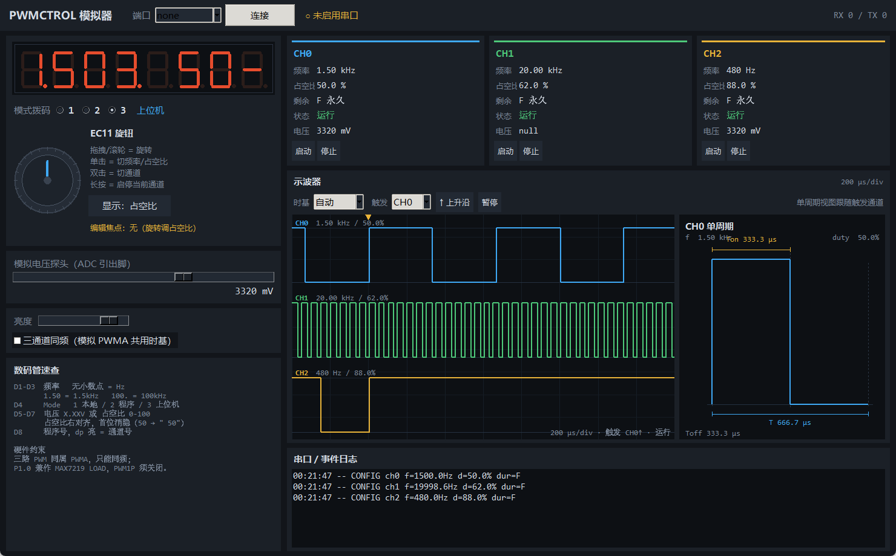

# PWMCTROL 下位机模拟器（Python）

用 Python 模拟整块 STC8H1K08 下位机：数码管面板 + EC11 旋钮 + 模式拨码 + 三路 PWM + 电压探头 + 串口协议。
目的：在硬件定稿前**先把靶画出来**，让上位机有真实对手可以对接。

```
sim/
├─ pwm_sim.py        模拟器主程序（GUI + 协议）
├─ requirements.txt  依赖（仅 pyserial）
├─ run_sim.bat       双击启动
├─ gui_preview.png   界面截图
└─ sim_store.json    运行后自动生成的配置存档
```



---

## 1. 快速开始

```bat
pip install -r requirements.txt
python pwm_sim.py --port COM1
```

参数：

| 参数 | 说明 |
| --- | --- |
| `--port COM1` | 监听哪个串口，默认 COM1 |
| `--port none` | 不开串口，只玩面板（面板、数码管、示波器照常工作） |
| `--selftest` | 不开 GUI，跑一遍协议与量化自检，验证环境 |

不想装依赖？`pyserial` 只用于串口，缺了也能启动（只是连不上串口）。

## 2. 虚拟串口怎么来

Windows 没有内核驱动就造不出真正的 COM 口，模拟器和上位机也不能同时打开同一个口。标准做法是装一对**虚拟串口对**（一端进、另一端出）：

1. 装 [com0com](https://sourceforge.net/projects/com0com/)（开源、驱动已签名）。
2. 在 `Setup Command Prompt` 里建一对：`install PortName=COM1 PortName=COM2`。
   - 若 COM1 已被主板串口占用，就改成 `COM11` / `COM12`，两边对应改。
3. **模拟器开 COM1，上位机开 COM2**（或反之），数据一边进一边出。

> 没有 com0com 时，用 `--port none` 也能验证面板交互；协议部分用 `--selftest` 验证。

## 3. 界面说明

```
┌─ 顶栏：端口 / 连接 / 链路状态 / RX·TX 计数 ────────────────────┐
├─ 左：面板                        右：三通道 + 示波器 + 日志 ────┤
│  · 8 位数码管（红七段 + dp）       · CH0/1/2 频率·占空比·剩余·状态·电压 │
│  · 模式拨码 1/2/3                  · 三路 PWM 波形（3 周期窗口）        │
│  · EC11 旋钮（拖/滚/点/双击/长按）  · 串口收发日志                        │
│  · 显示切换按钮                    │
│  · 电压探头滑杆 0~5000mV           │
│  · 亮度 + 三通道同频锁             │
└────────────────────────────────────┴────────────────────────────────────┘
```

### EC11 操作

| 动作 | Mode 1 本地 | Mode 2 程序 | Mode 3 上位机 |
| --- | --- | --- | --- |
| 拖拽/滚轮 | 改频率（编辑焦点=频率）或占空比 | 选程序号 0~9 | 忽略，D8 显示通道号 |
| 单击 | 频率 → 占空比 → 无 循环 | 启动/停止 | 切换 D5-D7 显示内容 |
| 双击 | 切通道 0→1→2 | 切通道 | 切通道 |
| 长按 | 启动/停止当前通道 | 启动/停止 | 无 |

被编辑的字段以 2Hz 闪烁；双击后 D8 的 dp 点亮、显示通道号 2 秒。

### 数码管字段

| 位 | 内容 | dp |
| --- | --- | --- |
| D1~D3 | 频率（Hz 整数 / kHz 有效数字） | 小数点位置即单位：无点=Hz，`1.50`=kHz，`20.0`=kHz，`100.`=kHz |
| D4 | Mode 1/2/3 | 常亮 |
| D5~D7 | 电压 `X.XX`V（带小数点）或占空比 `0`~`100`（右对齐、首位消隐，`50` 显示为 ` 50`） | 仅电压模式有点 |
| D8 | 程序号 0~9 / 通道号 | 亮=通道号 |

### 示波器面板

| 控件 | 作用 |
| --- | --- |
| 时基 | `自动` = 按触发通道取"10 格约装 3 个周期"，也可手选 1s ~ 100ns/div |
| 触发 | CH0/CH1/CH2 + ↑/↓ 边沿；触发点固定在屏幕 20% 处（顶部黄色三角） |
| 暂停 | 冻结波形便于读数和截图（通道数据照常刷新） |
| 单周期视图 | 右侧独立区域，画触发通道的**一个完整周期**，标注 `T` / `Ton` / `Toff` / `duty` |

三通道共用同一个时基，这是真示波器的行为。硬件上三路本来就同频，自动时基下三条都清楚；把时基调得过快时，低频通道会退化成一条常高/常低的直线——这不是 bug，是采样窗口小于一个周期的正常表现。想看某一路的细节，把触发源切到它，时基会自动跟着变。

## 4. 支持的协议（PROTO v1.1）

帧：上位机 `>`…`<`，下位机 `[`…`]`，字段分隔 `_`。

| 命令 | 说明 |
| --- | --- |
| `>TYPE-PWMCTROL<` | 识别，回 `[YES]` |
| `>PING<` / `>VER<` / `>INFO<` | 心跳 / 版本 / 设备信息 |
| `>MODE_<1|2|3><`、`>MODE?<` | 读写模式（1 本地 / 2 程序 / 3 上位机） |
| `>CONFIG_<ch>_<freq>_<duty>_<dur>_<adc><` | 配置并启动；`dur` 用 `F` 表示永久 |
| `>STOP<` / `>STOP_<ch><` | 全停 / 单停 |
| `>PROG_<ch>_<n>[_<p1>[_<p2>]]<` | 预制程序 0~9 |
| `>RATE_<ms><` / `>ECHO_<0|1|2><` | 上报周期 / 上报模式 |
| `>GET_<ch><` / `>ADCREAD_<ch><` | 单次查询 / 读电压探头 |
| `>GUARD_<ms><` / `>STAT<` / `>RESET<` | 通信看护 / 统计 / 软复位 |
| `>SAVE<` / `>LOAD<` | 存档 / 读档（当前实现为应答 + JSON 落盘） |

错误码：`E01` 通道号、`E02` 频率、`E03` 占空比、`E04` 时间、`E05` ADC、`E06` 字段数、`E07` 未知命令、`E08` 程序号、`E09` 故障锁存、`E11` 存储、`E12` 分辨率、`E13` 模式不允许。

**注意**：Mode 1/2 下 `CONFIG`/`PROG` 会被拒（`E13`），`STOP` 永远放行。所以上位机连上后先 `>MODE_3<`。

示例会话：

```
> TYPE-PWMCTROL<   →  [YES]
> MODE_3<          →  [OK_MODE_3]
> CONFIG_0_1500_37.5_5000_1<  →  [OK_0_1499.96_37.5_1]
                             ←  [ECHO_0_1499.96_37.5_3300_R]
> STOP<            →  [OK_STOP]
```

## 5. 模拟器与真机的差异（别把这些当成 bug）

| 项 | 模拟器 | 真机 |
| --- | --- | --- |
| 频率量化 | 用同一套 `ARR+1 = round(FOSC/(PSC·f))` 公式算，**结果会和真机一致到小数点后 2 位** | 同 |
| 三通道同频 | 默认独立；勾选"三通道同频"可模拟 PWMA 共用时基的真实行为 | **强制同频**（PWM1N/2N/4N 同属 PWMA） |
| 数码管 | Canvas 画的七段 | MAX7219 驱动，亮度 16 级 |
| EC11 | 鼠标拖拽/滚轮 | 正交编码器，5ms 扫描 |
| 24C02 | JSON 落盘 `sim_store.json` | 256B / 8B 页 / tWR 10ms |
| 过流保护 | 无（靠看护超时演示停机） | 只有软件判定（PWMFLT 脚被 EC11 占用） |
| ECHO 上报 | 50ms 内三帧错开 | 同 |

## 6. 协议自检

```bat
python pwm_sim.py --selftest
```

会跑 22 条命令（含全部错误码路径）+ 频率量化表 + 数码管格式化表，输出可直接贴进文档。

## 7. 已知取舍

- **线程安全**：串口读线程直接改设备模型，GUI 只读。串口命令与面板操作同时到达时理论上可能撞一次，实用无影响；要严格可加 `threading.Lock`。
- **示波器是示意图**：按频率/占空比画理想方波，不模拟上升沿、死区与噪声（真机低端驱动会看到 Vds 振铃）。
- **不模拟 100µs 软件引擎抖动**：低频通道在真机上有 ±100µs 抖动，示波器上是理想边沿。

---

相关文档：`../docs/01-系统架构设计文档.md`、`../docs/02-通信协议与指令文档.md`、`../docs/03-下位机固件结构文档.md`
