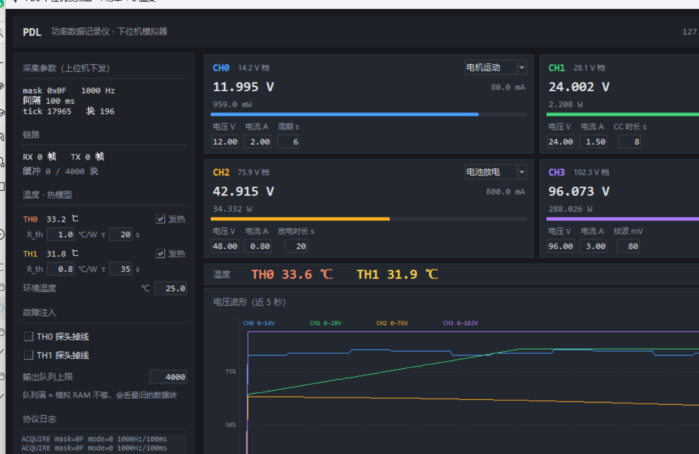

# PDL 下位机模拟器（Python）

用 Python 冒充整块 STM32F103C6T6：4 路功率（V+I）+ 2 路 DS18B20、USB HID 协议、触发、四档上报。
目的：**硬件还没画，上位机就有真实对手可以对接**。

```
simulator/
├─ run_sim.py          入口（CLI + 自检）
├─ pdl/
│  ├─ proto.py         帧格式、CRC、分片、块头
│  ├─ config.py        四路分压系数、换算、DS18B20 时间常数
│  ├─ scenarios.py     情景库（电机/充电/放电/电容/纹波/阶跃/扫频）
│  ├─ thermal.py       热模型（功率 -> 温度）
│  ├─ signals.py       情景输出 + ADC 量化
│  ├─ onewire.py       DS18B20（含 750 ms 延迟与 85℃ 陷阱）
│  ├─ sampler.py       tick 累积、RAW/BIN 块组装
│  ├─ trigger.py       V/I/P 触发 + 计数消抖
│  └─ device.py        状态机（与未来固件一一对应）
├─ transports/tcp.py   TCP 传输（按 64 B 切块）
├─ gui/app.py          Tkinter 面板
├─ tests/test_link.py  端到端链路测试
└─ gui_preview.png     界面截图
```

无第三方依赖，标准库即可运行（截图脚本才需要 Pillow）。

---

## 1. 快速开始

```bat
cd simulator
run_sim.bat                        :: 或者 python run_sim.py
```

默认监听 `127.0.0.1:5555`。冒烟前建议先跑自检：

```bat
python run_sim.py --selftest
```

会跑 13 组共 50 项检查（帧/CRC/流式解码、四路换算、IDENTIFY、逐通道配置、ACQUIRE 收块、块头、ABORT 排空、运行中禁改、触发消抖、DS18B20、BIN 聚合、情景曲线、热模型），全部通过才动界面。

参数：

| 参数 | 说明 |
|---|---|
| `--listen 127.0.0.1:5555` | TCP 监听地址 |
| `--selftest` | 只跑协议自检，不开界面 |
| `--headless` | 无界面运行（配合上位机或 CI） |
| `--hid-pacing on\|off` | 模拟 USB FS 的 64 B / 1 ms 限速，**默认 on** |
| `--time-scale N` | 时钟加速 N 倍，用来验证长跑（1 小时压成 36 秒） |
| `--ram N` | 输出队列上限（模拟 10 KB RAM 的缓冲深度） |
| `--fault-temp-lost 0\|1` | 让指定温度探头掉线 |

---

## 2. 界面



```
┌ 顶栏：PDL / 监听地址 / 状态 / 连接灯 ─────────────────────────┐
├ 左栏 ───────────┬ 右侧 ─────────────────────────────────────┤
│ 采集参数(只读)   │ 4 张功率卡（2×2）                         │
│ 链路 RX/TX       │   情景下拉 · 电压/电流/功率 · 量程条        │
│ 温度·热模型      │   电压/电流/情景参数 可编辑                 │
│  R_th / τ / 环境 ├ 温度条：TH0 / TH1 / 板载 ──────────────────┤
│ 输出队列上限     ├ 电压波形：四路按各自满量程归一化 ──────────┤
│ 协议日志         │                                          │
└─────────────────┴──────────────────────────────────────────┘
```

要点：

- **四路量程不同**（14.2 / 28.1 / 75.9 / 102.3 V），卡片直接标在标题上，量程条按本路满量程算。
- 波形按**各自满量程归一化**，否则 12 V 的曲线被 96 V 的压成一条直线。
- 改电压/电流/纹波后按回车或移开焦点即生效，下一次 tick 就能看到。
- 「探头掉线」勾上是真的断——上位机会收到 `TEMP_LOST`，而不是 85 ℃。
- **输出队列上限**就是模拟 RAM：填小一点（比如 200）就能复现"上位机读得慢 → 丢块"。

---

## 3. 情景库：让通道吐出"像真事"的数据

每张卡片右上角选情景，左边填电压/电流，第 4 格会**随情景变义**（周期 / 时长 / 容量 / 纹波 / 阶跃倍数）。

| 情景 | 行为 | 第 4 格 | 用来验证 |
|---|---|---|---|
| **电机运动** | 加速冲击(1.8×)→匀速(0.9×)→减速回馈(**负电流**)→停歇，母线按内阻跌落 | 周期 s | 双向电流、母线跌落、尖峰 |
| **充电 CC-CV** | 恒流升压到 v_set，转恒压后电流指数衰减 | CC 时长 s | 触发"到电压开/关"、功率包络 |
| **电池放电** | 前段平缓、后段膝点陡降 | 放电时长 s | 长跑趋势、低压告警 |
| **电容充电** | V=Vs(1-e^-t/RC)，初始电流冲击 | 容量 mF | 大电流尖峰、RC 常数 |
| **电容放电** | V=V0 e^-t/RC，电流随压降 | 容量 mF | 衰减曲线 |
| **开关纹波** | 直流 + 40 kHz 纹波 + 可设负载跳变 | 纹波 mV | 纹波测量、瞬态恢复 |
| **假负载阶跃** | 电流在某时刻突变 | 阶跃倍数 | 负载调整率、热响应 |
| **电压扫频** | 正弦慢扫 | 周期 s | 全量程线性度 |
| **恒定输出** | 不动 | 纹波 mV | 核对换算与量程 |

默认四路已经配好四种不同情景（电机 / 充电 / 放电 / 纹波），开箱就能看到四种波形。

## 4. 热模型：放电与假负载会真的把温度顶上去

```
T_target = 环境温度 + P × R_th
T        <- T + (T_target − T) × (1 − e^(−dt/τ))
```

- **R_th（℃/W）**：稳态能升多少度。功率翻倍，温升翻倍。
- **τ（秒）**：多久升上去。大 → 像整块铝壳，小 → 像裸露的 MOS。
- 每路探头默认只受"本通道"加热，`bound_mask` 可以改成多路叠加。
- 关掉"发热"勾选，温度就固定在环境温度，用来做对照。

默认：TH0 跟 CH0（R_th 1.0、τ 20 s），TH1 跟 CH1（R_th 0.8、τ 35 s）。
把 CH0 切到「假负载阶跃」并把阶跃倍数调到 3，就能看到温度台阶式上升——这正是上位机要能画出来的东西。

> DS18B20 本身还有 750 ms 转换延迟，所以温度条上的读数会比左栏的模型值慢半拍，这是刻意的。

---

## 5. 和上位机联调

```bat
:: 1. 启动模拟器
python run_sim.py --listen 127.0.0.1:5555

:: 2. 上位机（Avalonia）
dotnet run --project ..\PDL_upper\PDL_upper.csproj -- --tcp 127.0.0.1:5555
```

上位机侧要做的第一件事：

```
IDENTIFY(nonce)          → 校验 magic="PDL1" 且 nonce 回显
GET_CH_CONFIG  x6        → 4 路功率 + 2 路温度，拿到各自的 v_fs_dv 与换算系数
TIME_SYNC                → 算 offset
READ_TEMP_ONCE           → 立刻显示室温
GET_STATUS               → 确认 IDLE
```

> **少读一条 `GET_CH_CONFIG`，就会有一路按错误的量程显示**（比如 CH3 按 CH0 的 14.2 V 算，读数差 7 倍）。

---

## 6. 自检与端到端测试

```bat
python run_sim.py --selftest      :: 协议层 40 项
python tests\test_link.py         :: 真开 TCP，客户端跑完整流程 12 项
```

`test_link.py` 会起一个真 socket、连上来、发 IDENTIFY / GET_CH_CONFIG ×6 / ACQUIRE、收 600 ms 数据、ABORT，并核对 tick 数与块头。

---

## 7. 与真机的差异（别当 bug）

| 项 | 模拟器 | 真机 |
|---|---|---|
| ADC | 量化到 12 bit + 高斯噪声 | 同，另有 INL/DNL、温漂 |
| 通道偏斜 | 无（同一时刻取值） | 顺序扫描，同通道 V/I 差 1.86 µs |
| DS18B20 | 模拟 750 ms 转换、85℃ 默认值、掉线 | 同，另有 CRC 错、线长导致的时序失败 |
| USB | TCP + 可选 1 ms 限速 | 真 HID，1 ms 事务，有枚举/复位 |
| 触发 | 严格按 tick 判定 | 同，但中断抢占会带来 µs 抖动 |
| RAM | `--ram` 控制队列深度 | 10 KB，包含 USB 缓冲与栈 |

---

## 8. 已知取舍

- **时间戳是"应该采样的时刻"**，不是"采样完成的时刻"：`next_tick_us += period` 保证不累积漂移，真机也是这么做的。
- **主循环 1 ms 调一次 `dev.step()`**，内部会把这一毫秒内该采的 tick 全部补上（时间戳仍然精确）。这样既省 CPU，又不会和发送线程抢 GIL。
- **Windows 上会调 `timeBeginPeriod(1)`**，否则 `sleep(0.001)` 实际睡 15 ms，数据会成批涌出。
- **BIN 模式不模拟桶内的真实波形**，只按当前信号算 min/max/avg/rms —— 对验证协议和上位机足够。

---

相关文档：`../docs/02_HID通信协议.md`、`../docs/01_系统架构.md`、`../docs/05_模拟器与上位机实现计划.md`
